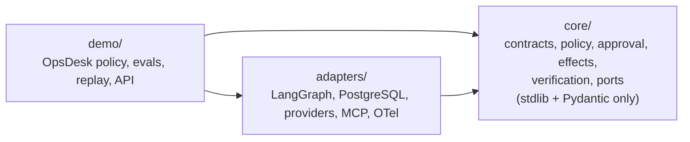

# Agent Reliability Runtime

## What it is

Agent Reliability Runtime (ARR) is a local-first reference runtime for tool-using
AI agents whose actions have real side effects. It provides a framework-neutral
reliability core — trusted policy, exact approval, idempotent effect receipts and
postcondition verification — with replaceable adapters for LangGraph, PostgreSQL,
model providers, MCP and OpenTelemetry. A fictional OpsDesk demo shows one durable
agent end to end, and every accepted capability is tied to machine-checkable proof.

[**Static Evidence Demo**](https://agent-reliability-runtime.vercel.app/)

## Why it exists

An agent that calls tools can retry a payment, act on a stale approval or report
success that never happened. ARR treats model output as untrusted input and puts
deterministic checks between the model and every side effect: the model proposes,
policy decides, a human approves the exact action, the effect runs once, and the
outcome is verified before the run completes.

## Reliability properties

The runtime treats model, retrieval, memory and MCP content as untrusted data.
Side effects require schema validation, trusted policy and an exact approval.
PostgreSQL-backed checkpoints and effect receipts cover process restart and
duplicate delivery. The accepted capability map is tied to the machine-readable
[PROOF_INDEX](docs/project/PROOF_INDEX.json).

| Capability | Proof ID |
| --- | --- |
| Provider boundary | `provider-boundary` |
| Hybrid retrieval and citations | `hybrid-retrieval-citations` |
| Five-tool MCP boundary | `mcp-five-tools` |
| Deterministic policy | `deterministic-policy` |
| Exact approval | `exact-approval` |
| Idempotent side effects | `idempotent-side-effects` |
| Durable restart | `durable-restart` |
| Governed memory | `governed-memory` |
| OTel and audit | `otel-audit` |
| Evaluation harness | `eval-harness` |
| Adversarial scenarios | `adversarial-scenarios` |
| Static Evidence Demo | `static-evidence-demo` |

## Repository layout



Dependencies point inward only; `tests/unit/test_core_boundary.py` enforces it.

## Architecture at a glance

The current flow is memory scope -> retrieval -> model -> typed actions ->
trusted policy -> approval -> idempotent effect -> postcondition verification ->
result -> audit/OTel/evaluation. See the [architecture](docs/project/ARCHITECTURE.md)
for ownership and data-flow details. The [extension points](docs/extension-points.md)
describe implemented ports and explicitly planned interfaces. `core/` depends only
on Python stdlib and Pydantic; `adapters/` contains LangGraph, PostgreSQL, provider,
MCP session and OTel integrations; `demo/` owns OpsDesk policy and composition.

## Building on ARR

Implement the structural ports in `agent_reliability_runtime.core.ports` to plug
ARR's reliability semantics into another orchestrator, store or domain.
[Extension points](docs/extension-points.md) lists implemented and planned ports,
their current limits and the 1.x migration table. Implementing a port alone does
not automatically reproduce every composed reliability invariant.

Two architectures are built on these ports:

- [reliable-ai-agents-for-enterprise-workflows](https://github.com/yasuss/reliable-ai-agents-for-enterprise-workflows) —
  AI agents resolving ERP and finance exceptions over days, with exact approval,
  reconciliation and verified completion.
- [agent-safe-mcp-for-product-analytics](https://github.com/yasuss/agent-safe-mcp-for-product-analytics) —
  an MCP action layer for product analytics with project/region scoping,
  execution-boundary authorization, retry-safe writes and budgets.

Both linked repositories are architecture specifications with explicit ARR mappings;
neither is claimed here as a runtime dependency of ARR.

## Quickstart

Prerequisites: Git, uv 0.12.23, Python 3.12, Node.js 24 with npm, and Docker
Desktop/Engine with Compose and Linux containers.

```text
python scripts/bootstrap.py
uv run python scripts/reset_demo.py --confirm-development-reset
uv run python scripts/verify.py --scope all
```

These commands use a disposable local PostgreSQL/pgvector database and do not
require Ollama. Bootstrap installs locked dependencies, starts Compose and runs
migrations/checkpoint setup. Reset restores only fictional `demo_*` state. The
third command runs the documentation, static, frontend and database gates.

## Optional live local model path

The deterministic quickstart is independent of model availability. Live local
inference uses Ollama with exactly `qwen3:4b` for chat and
`qwen3-embedding:0.6b` for embeddings:

```text
ollama pull qwen3:4b
ollama pull qwen3-embedding:0.6b
uv run python scripts/probe_providers.py
```

The probe never downloads models automatically and accepts only a loopback Ollama
server. Ingestion, runs, approvals and live evaluation are documented in
[Operations](docs/project/OPERATIONS.md).

## Verification

The fail-fast verifier runs Ruff, mypy, unit tests, web checks, the documentation
truth gate and the deterministic secret scan. Database verification uses an
explicit disposable `ARR_TEST_DATABASE_URL`; CI runs PostgreSQL integration on
Ubuntu and static/unit gates on Ubuntu, Windows and macOS. See
[Verification](docs/project/VERIFICATION.md) for exact scopes and evidence.

## Static Evidence Demo

The web app is a static recorded-replay viewer. It has no backend, live inference
or arbitrary prompt input. Five accepted replay/receipt pairs are checked by
`scripts/verify_static_evidence.py`; the critical Chromium path is covered by
`web/e2e/static-evidence.spec.ts`.

## Support and limitations

See the [support matrix](docs/project/SUPPORT_MATRIX.md) for TESTED versus
EXPECTED environments and [limitations](docs/project/LIMITATIONS.md) for claim
boundaries. Development Compose credentials are fictional and must not be
deployed.

## License and public API

Agent Reliability Runtime uses the [Apache License 2.0](LICENSE).
[SECURITY.md](SECURITY.md) describes responsible disclosure. Agent Reliability
Runtime 2.x exposes the typed contracts in `agent_reliability_runtime.core.ports`
documented in [Extension points](docs/extension-points.md). Internal Python
imports moved and may break; the existing CLI command, MCP server launch and
Quickstart scripts remain supported. Dependency extras are not currently part of
the public extension contract; a core-only installation is not claimed.

The historical v1.0.0 tag and static recorded-replay deployment remain unchanged.

## Documentation map

- [Architecture](docs/project/ARCHITECTURE.md)
- [Operations](docs/project/OPERATIONS.md)
- [Verification](docs/project/VERIFICATION.md)
- [Support Matrix](docs/project/SUPPORT_MATRIX.md)
- [Limitations](docs/project/LIMITATIONS.md)
- [Evidence & Proof](docs/project/EVIDENCE_AND_PROOF.md)
- [Project truth map](docs/project/README.md)
- [Release and deployment operations](docs/project/RELEASE_AND_DEPLOYMENT.md)
- [Extension points](docs/extension-points.md)
- [Changelog](CHANGELOG.md)
- [ADR-0001](docs/project/decisions/ADR-0001-initialization-revalidation.md)
- [ADR-0002](docs/project/decisions/ADR-0002-core-adapters-demo.md)
- [Security policy](SECURITY.md)
